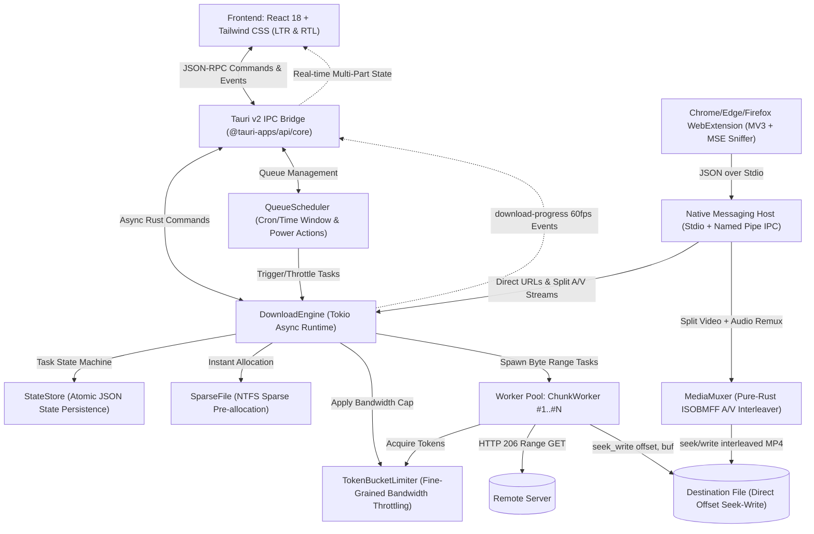

# OctoHeft Architecture & Clean-Room IDM Extraction Report

**Role**: Principal Systems Engineer & Reverse Architecture Specialist  
**Target Subject**: Internet Download Manager (`C:\Program Files (x86)\Internet Download Manager\`)  
**Product**: OctoHeft — Next-Generation Modern Download Accelerator  

---

## 1. Executive Summary & Forensic Analysis

Internet Download Manager (IDM) by Tonec Inc. has been a core Windows download utility for decades. Our clean-room reverse architectural inspection of `C:\Program Files (x86)\Internet Download Manager\` and its associated runtime registries reveals both the core algorithms and the legacy constraints of its Win32 architecture.

### Forensic Findings from Local Artifacts

| Component | Local Path / Registry | Mechanical Behavior & Findings |
| :--- | :--- | :--- |
| **Native Messaging Host** | `IDMMsgHost.exe` `IDMMsgHost.json` `HKCU\Software\Google\Chrome\NativeMessagingHosts\com.tonec.idm` | Connects browser extensions (Chrome, Edge, Firefox) via standard I/O (32-bit length-prefixed JSON) and shuttles intercepted URLs to IDMan via Named Pipes (`\\.\pipe\...`). |
| **Kernel Interceptors** | `idmwfp32.sys`, `idmwfp64.sys` `idmtdi32.sys`, `idmtdi64.sys` | Windows Filtering Platform (WFP) and legacy TDI drivers to inspect raw TCP sockets and hijack browser network streams. |
| **System Hooks** | `idmmkb.dll` `idmbrbtn.dll` `IDMShellExt64.dll` | `SetWindowsHookEx` hooks for catching keyboard clicks (e.g. `Alt+Click`) and injecting video download overlay buttons into browser windows. |
| **State Registry** | `HKCU\Software\DownloadManager\` `...\<task_id>\ChList` | Stores download metadata and a binary-encoded linked list of chunk records: `struct ChunkRecord { uint32_t id; uint32_t next_id; uint64_t start_pos; }` (16 bytes per chunk). |
| **Queue & Scheduler** | `%APPDATA%\IDM\Scheduler\` (`s_1.dt`, `q_1.dt`) `HKCU\Software\DownloadManager\Queue` | Binary serialized queue schedules, day-of-week bitmasks (0-127), and post-download action triggers (Shutdown, Sleep, Hang up). |
| **Disk Storage (Flaw)** | `%APPDATA%\IDM\DwnlData\<user>\<task>\` | **Legacy Inefficiency**: Writes separate chunk files (`file.ext`, `file.ext1`, `file.ext2`... `file.ext8`). At 99.9%, it forces a complete disk concatenation rebuild, doubling disk wear and causing CPU/disk stalls. |

---

## 2. Dynamic Chunking & Segmentation Analysis

### IDM's Linked-List Dynamic Segmentation
From forensic inspection of live IDM logs (`log_1505.log`), IDM's chunking sequence was decoded:
1. **Initial Probe (C0)**: Issues an HTTP `GET` request. Detects `Accept-Ranges: bytes` and `Content-Length`.
2. **Dynamic Splitting**:
   - Connection 0 downloads `0..1,427,519`.
   - As Connection 1 becomes ready, it claims `1,427,520..end`.
   - Connection 2 connects and splits Connection 1's remaining half (`45,840,167..end`).
   - Connection 3 connects and splits Connection 2's remaining half (`67,923,610..end`).
   - Chunks are linked via `nextID`. When an active chunk worker finishes, it inspects remaining active chunks, splits the largest in half, and takes the upper range.

### OctoHeft Modern Clean-Room Improvements
1. **Zero-Assembly Direct Offset Seeking**:
   - Instead of writing `file.ext1`, `file.ext2` and copying them at the end, OctoHeft pre-allocates the destination file immediately (`FSCTL_SET_SPARSE` or `set_len`).
   - Parallel `ChunkWorker`s utilize concurrent OS file seek writes (`std::os::windows::fs::FileExt::seek_write`) directly into non-overlapping byte positions.
   - **Download completes at the exact millisecond the final network packet arrives** — 0 ms reassembly overhead.
2. **Dynamic Work Stealing**:
   - Worker pool tracks continuous byte offsets using atomic markers (`AtomicU64`).
   - When a connection finishes its range, it dynamically bifurcates the largest remaining active segment if $> 2\text{ MB}$ remains.

---

## 3. OctoHeft System Architecture

---

## 4. Media Sniffer, MSE Stream Capture & Browser Integration Architecture

### Manifest V3 Browser Extension (`native_messaging/extension/`)
1. **MSE Stream Capture & YouTube Resolution (`background.js`)**:
   - YouTube and modern adaptive players feed MediaSource Extensions (`blob:https://...`), which cannot be fetched directly by external HTTP clients.
   - Intercepts `*://*.googlevideo.com/videoplayback*` via `chrome.webRequest.onBeforeRequest` and `onHeadersReceived`, separating video (`mime=video/...`) and audio (`mime=audio/...`) tracks, classifying codecs/resolution (`itag`, `mime`, `clen`), and calling `stripTransientRangeParams` (`range`, `rn`, `rbuf`, `rbuf_*`) to turn ranged segment URLs into full replayable adaptive stream URLs.
   - Executes `extractYouTubePlayerStreams` inside `world: "MAIN"` via `chrome.scripting.executeScript` to inspect `#movie_player.getPlayerResponse()` / `window.ytInitialPlayerResponse` (`streamingData.adaptiveFormats`), prioritizing MP4 H.264/AVC (`avc1`) + AAC (`mp4a`) adaptive streams compatible with zero-FFmpeg MP4 remuxing, and extracting the clean video title.
   - Never dispatches `blob:` URLs over Native Messaging (`isHttpUrl` guard in both `background.js` and `native_host.rs`).
2. **Global Download Interception (`background.js`)**:
   - Hooks `chrome.downloads.onDeterminingFilename` replicating IDM's `HKCU\Software\DownloadManager\Extensions` rule table (`3GP`, `7Z`, `AAC`, `ACE`, `AIF`, `APK`, `ARJ`, `ASF`, `AVI`, `BIN`, `BZ2`, `EXE`, `GZ`, `GZIP`, `IMG`, `ISO`, `LZH`, `M4A`, `M4V`, `MKV`, `MOV`, `MP3`, `MP4`, `MPA`, `MPE`, `MPEG`, `MPG`, `MSI`, `MSU`, `OGG`, `OGV`, `PLJ`, `PPS`, `PPT`, `QT`, `RA`, `RAR`, `RM`, `RMVB`, `SEA`, `SIT`, `SITX`, `TAR`, `TIF`, `TIFF`, `WAV`, `WMA`, `WMV`, `Z`, `ZIP`, `PKG`, plus `/^R[01]\d*$/i` multipart RAR volumes `.r00`/`.r01`).
   - Cancels and erases Chrome's native download for matched HTTP/HTTPS targets, attaches session cookies (`chrome.cookies.getAll`), referrer, and User-Agent, and forwards to OctoHeft (`blob:`/`data:` URLs invoke `suggest()` natively).
   - Embeds an RSA-2048 public `"key"` inside `manifest.json` to lock a deterministic Chromium Extension ID (`kalfiofhhhcdnnkjehidagebfikodflp`).
3. **Floating Video Grabber (`content.js` & `overlay.css`)**:
   - Monitors HTML5 `<video>` elements via `MutationObserver` and YouTube `yt-navigate-finish` transitions (`RESET_YT_TAB_MEDIA` on load and SPA navigation), anchoring directly to `video.closest('#movie_player') || video.closest('.html5-video-player') || video.parentElement` at `z-index: 2147483647`.
   - Implements hover-lock (`800 ms` `mouseleave` grace period, explicit `mouseenter` hover-lock, `e.stopPropagation()` on mouse/pointer/click events).
   - Dispatches `RESOLVE_VIDEO_DOWNLOAD` so the service worker resolves paired split A/V streams instead of sending `blob:` URLs.
4. **Unified Native Messaging Host & Named Pipe IPC (`src-tauri/src/engine/native_host.rs`)**:
   - Replaces external Python/batch wrappers directly inside `OctoHeft.exe` via `should_run_as_native_host(&args)` before Tauri/WebView2 initialization.
   - Reads/writes 32-bit length-prefixed JSON frames over stdio, validates HTTP/HTTPS URLs (`is_valid_external_url`, rejecting `blob:`/`data:`/`file:`), routes either single downloads or split video+audio pairs (`videoUrl` + `audioUrl`) through `\\.\pipe\OctoHeftNativeIpc` to `DownloadEngine` / `MediaMuxer`, or queues offline into `StateStore`.
   - Native Host manifests (`com.antigravity.octoheft*.json`) are registered in HKCU across Google Chrome, Microsoft Edge, Brave, and Mozilla Firefox.

---

## 5. Advanced Queue Scheduler & Power Control

### Execution Engine (`src-tauri/src/engine/scheduler.rs`)
- **Queue Persistence**: Supports multiple independent queues with user-defined concurrency caps.
- **Time Windows**: Configurable Start Time (`HH:MM`) and Stop Time (`HH:MM`) with day-of-week bitmasks (Sunday through Saturday).
- **Automated Work Handoff**: When an active download completes, the scheduler immediately pulls and starts the next queued item.
- **Post-Completion Power Triggers**:
  - `SleepPC`: Invokes Windows `powrprof.dll,SetSuspendState 0,1,0`.
  - `ShutdownPC`: Invokes Windows `shutdown.exe /s /t 30 /c "OctoHeft download queue completed"`.
  - `ExitApp`: Gracefully shuts down the background application.

---

## 6. Token-Bucket Rate Limiter (`src-tauri/src/engine/rate_limiter.rs`)

A high-precision, lock-free token bucket limiter ensures bandwidth compliance across all threads:
- **Replenishment**: Microsecond-accurate token accumulation:
  $$\text{tokens} = \min(\text{tokens} + \Delta t \times \text{rate}, \text{burst\_capacity})$$
- **Dynamic Throttling**: Interactive slider allows real-time speed adjustments (5 MB/s, 10 MB/s, Unlimited) without restarting active transfers.
- **Worker Integration**: Parallel `ChunkWorker`s cooperatively acquire tokens before writing buffers to disk.

---

## 7. Batch URL Pattern Expander (`src-tauri/src/engine/batch.rs`)

- Zero-padded numeric patterns: `https://site.com/file_[001-050].zip` $\to$ 50 sequentially generated URLs preserving padding width.
- Standard numeric patterns: `https://site.com/part-[1-10].bin`.
- Alphabetical patterns: `https://site.com/track_[a-z].mp3`.

---

## 8. Remote ZIP Central Directory Inspection & Slicing (`src-tauri/src/engine/zip_preview.rs`)

1. **PKZIP Specification Traversal**: Requests trailing 64 KB (`Range: bytes=-65536`), locates EOCD (`0x06054b50`), and reads Central Directory File Headers (`0x02014b50`).
2. **Selective Extraction**: Computes exact compressed byte range ($\text{Start} = \text{LocalHeaderOffset} + 30 + \text{NameLen} + \text{ExtraLen}$), fetches that slice via HTTP `Range`, and decompresses on the fly with `flate2::read::DeflateDecoder`.

---

## 9. Network Proxy & Authentication Engine (`src-tauri/src/engine/proxy_auth.rs`)

- **Proxy Types**: System Default discovery, Manual HTTP/HTTPS proxies, and SOCKS5 proxies with optional authentication.
- **Per-Domain Credential Store**: Persists domain-specific rules (`Basic` Base64, `Bearer` tokens, custom HTTP headers).

---

## 10. Streaming Integrity Hasher & Antivirus Hook (`src-tauri/src/engine/post_process.rs`)

- **Continuous Streaming Hasher**: Computes SHA-256 and MD5 checksums alongside disk writes.
- **Windows Defender CLI Integration**: Executes `MpCmdRun.exe -Scan -ScanType 3 -File "<filepath>"`.

---

## 11. Windows System Tray & Lifecycle (`src-tauri/src/tray.rs`)

- **Tauri v2 Tray System**: Persistent tray icon (OctoHeft branding) with Toggle Window, Resume All, Pause All, and Exit, plus `CloseRequested` minimization to background tray.

---

## 12. Native In-Memory Stream Muxer (`src-tauri/src/engine/media_muxer.rs`)

### Forensic Analysis & Clean-Room Implementation
- **Zero External FFmpeg Dependency**: OctoHeft avoids bundling a 70+ MB FFmpeg binary, maintaining a small native release executable (< 15 MB).
- **Pure-Rust Stream Parsers & ISOBMFF Box Demuxer**:
  - **HLS (`.m3u8`)** & **DASH (`.mpd`)**: Extracts video & audio tracks and initialization segments (`#EXT-X-MAP` / `SegmentTemplate`).
  - **Fragmented MP4 (`fMP4`) Demuxer (`parse_isobmff_samples`)**: Directly parses ISOBMFF container boxes (`moov`/`trak`/`mdia`/`minf`/`stbl`/`stsd`, `mvex`/`trex`, and fragment boxes `moof`/`mfhd`/`traf`/`tfhd`/`tfdt`/`trun` + `mdat`) to recover sample byte slices, DTS durations, sync flags, `AvcConfig` (`sequence_parameter_sets`, `picture_parameter_sets`), and `AacConfig` from adaptive streams.
  - **Split-Stream Parallel Downloader & Chronological Interleaver (`download_and_remux_split_streams`, `write_muxed_mp4`)**: Fetches separated H.264/AVC video and AAC audio streams concurrently via `tokio::join!`, demuxes elementary samples in memory, interleaves video and audio samples by timestamp (`dts / timescale`), and synthesizes a unified playable `.mp4` container (`ftyp`, `moov`, interleaved `mdat`).

---

## 13. Automatic Category Dispatcher (`src-tauri/src/engine/categories.rs`)

- Classifies downloads by extension and MIME type into `Compressed`, `Programs`, `Video`, `Audio`, and `Documents`, persisted in `categories_state.json`.

---

## 14. Windows Shell Integration & Queue Priority Reordering

- **Auto-Start**: `HKCU\Software\Microsoft\Windows\CurrentVersion\Run\OctoHeft` registers `"<exe>" --minimized`.
- **Custom URI Scheme**: `HKCU\Software\Classes\octoheft` handles `octoheft://download?url=...`.
- **Explorer Context Menu**: `HKCU\Software\Classes\*\shell\OctoHeftChecksum` adds "Verify checksum with OctoHeft".
- **Interactive Queue Priority Reordering**: HTML5 drag-and-drop and Up/Down nudges tracked via `order_index`.

---

## 15. Internationalization (i18n), RTL Support & Multi-Language Packaging

1. **OS Locale Detection (`src-tauri/src/engine/settings.rs`)**: Queries Windows UI language via `GetUserDefaultLocaleName` (`Win32_Globalization`), normalizes BCP-47 tags across `en`, `fr`, `es`, `de`, `ar`, `ru`, and `zh`, and persists choices in `settings_state.json`.
2. **React Context & CSS Logical RTL (`src/i18n/index.tsx`)**: Dynamically updates `document.documentElement.lang` and `document.documentElement.dir` (`rtl` for Arabic, `ltr` otherwise) without restart, backed by Tailwind CSS logical properties (`ms-*`, `me-*`, `ps-*`, `pe-*`, `start-*`, `end-*`, `text-start`, `text-end`, `border-s`, `border-e`).
3. **Multi-Language NSIS Installer (`tauri.conf.json`, `nsis/installer.nsi`, `nsis/hooks.nsh`)**: Enables `English`, `French`, `Spanish`, `German`, `Arabic`, `Russian`, and `SimpChinese` installer UIs (`displayLanguageSelector: true`), injects localized `NSIS_HOOK_LANGSTRINGS` (`BrowserExtCheckboxText`), applies `nsDialogs::SetRTL 1` on the Finish page when `$(^RTL) = 1`, registers `NativeMessagingHosts\com.antigravity.octoheft` and `.octodl` associations, and cleanly purges all keys/manifests/resources on uninstall.

---

## 16. Production Hardening, Observability & Security

- **Structured Tracing & Ring Buffer (`src-tauri/src/engine/logging.rs`, `error.rs`)**: Daily rolling logs (`octoheft.log.<YYYY-MM-DD>`) in `%LOCALAPPDATA%\OctoHeft\logs\` (or `./data/logs`) paired with a 500-event ring buffer UI and typed `EngineError` recovery.
- **Automated Integration Test Harness (`src-tauri/tests/engine_integration.rs`)**: Mock HTTP/1.1 range & PKZIP integration suite alongside unit tests for fMP4 split-stream muxing, Native Messaging URL guards, locale detection, and settings persistence.
- **Clean-Room Compliance**: Built strictly on open RFC 9110 HTTP Range, ISO/IEC 14496-12 ISOBMFF container specs, and Chromium Native Messaging standards; zero IDM licensing or DRM code reused.
