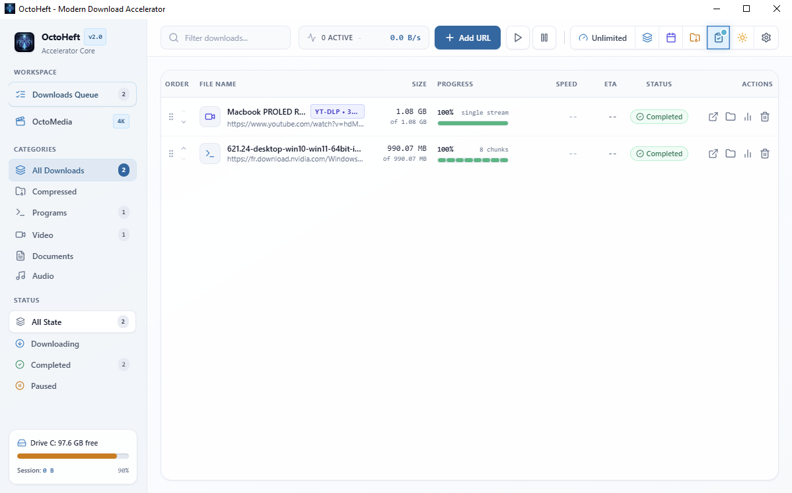
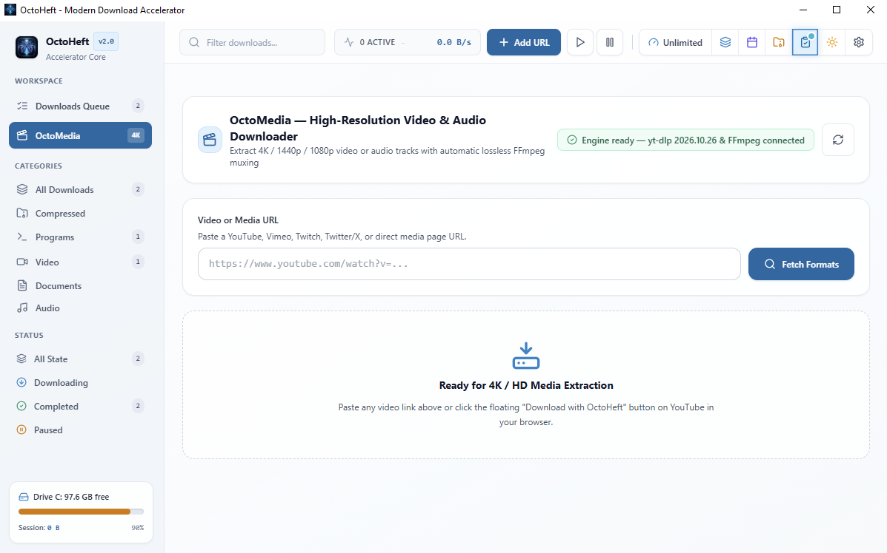
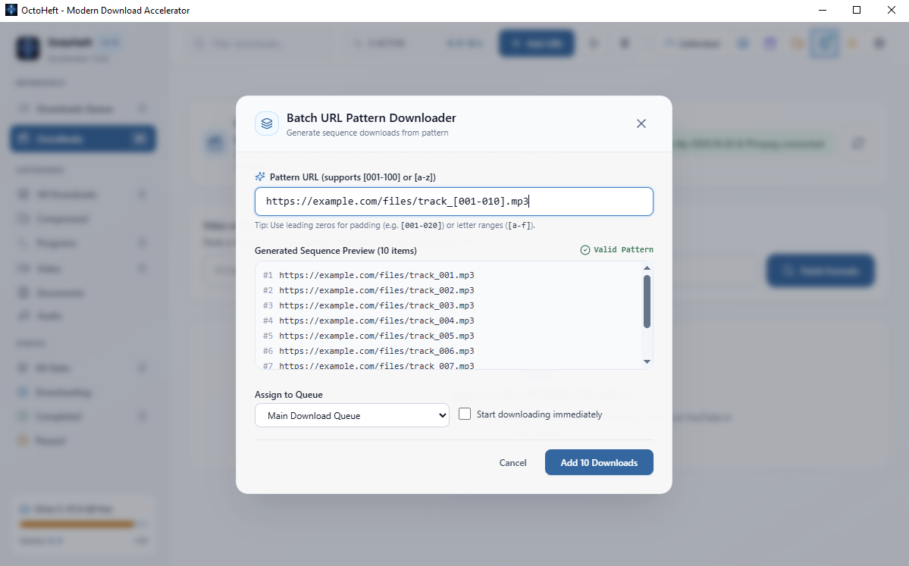
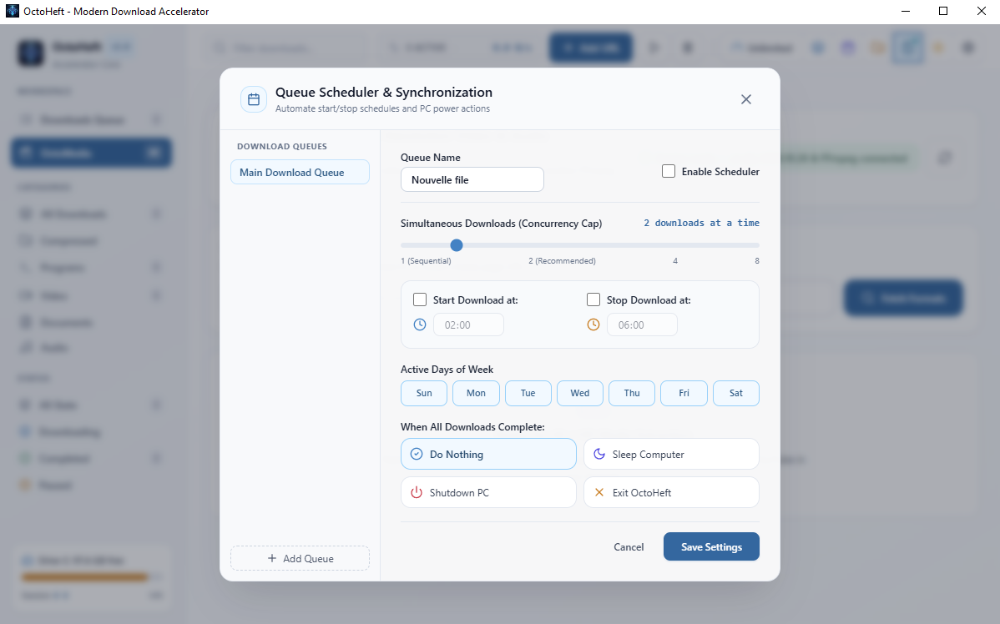
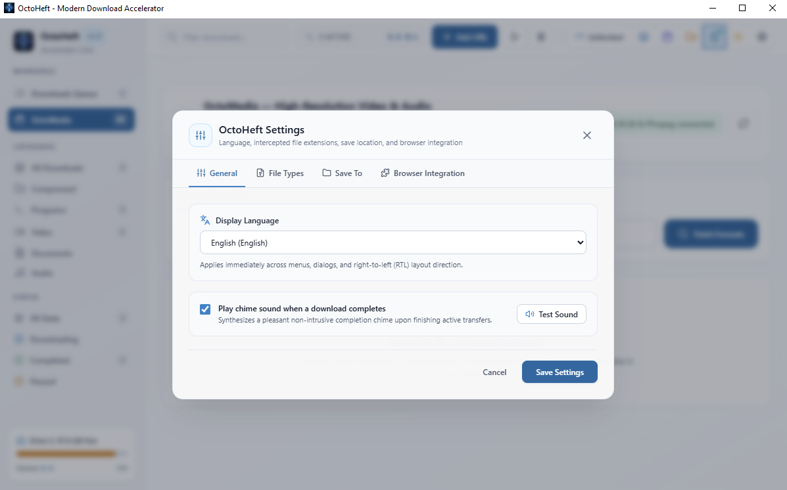

<div align="center">

# OctoHeft

<p align="center">
  
</p>

[](https://alternativeto.net/software/octoheft/about/?utm_source=badge&utm_medium=referral)

### *High-Speed, Zero-Assembly Parallel Download Accelerator for Windows*

[](https://www.rust-lang.org/)
[](https://v2.tauri.app/)
[](https://react.dev/)
[-0078d6?style=for-the-badge&logo=windows&logoColor=white)](https://microsoft.com/windows)
[](https://github.com/)
[](LICENSE)
[-10b981?style=for-the-badge&logo=virustotal&logoColor=white)](https://www.virustotal.com/)

<p align="center">
  <b>OctoHeft</b> is a modern, clean-room download accelerator engineered in Rust and TypeScript. It replaces thirty years of legacy Win32 download manager design patterns with true Direct I/O sparse allocation, native Chromium/Firefox WebExtension hooks, seamless Windows OLE shell drag-and-drop, and pure-Rust in-memory media multiplexing.
</p>

---

</div>

## Architectural Genesis: Why OctoHeft over Internet Download Manager (IDM)?

For over two decades, Internet Download Manager (IDM) by Tonec Inc. has served as the benchmark for multi-connection HTTP download acceleration on Windows. However, architectural forensics of legacy implementations (`IDMan.exe`, `idmwfp64.sys`, and `%APPDATA%\IDM\DwnlData\`) reveal fundamental design bottlenecks rooted in 1990s Win32 paradigms that degrade performance on modern multi-gigabit fiber connections, high-core-count CPUs, and PCIe Gen4/Gen5 NVMe solid-state drives.

OctoHeft was engineered from the ground up to solve these structural bottlenecks using modern systems programming principles.

```
┌──────────────────────────────────────────────────────────────────────────────────────────┐
│                             LEGACY IDM CONCATENATION PIPELINE                            │
│                                                                                          │
│  Network Stream ──> [Chunk 0 File] ──┐                                                   │
│  Network Stream ──> [Chunk 1 File] ──┼─> [99.9% Barrier] ─> [Sequential File Concat] ──> │ Final File
│  Network Stream ──> [Chunk 2 File] ──┤   Stalls UI/Disk     Double Write Amplification   │ (Minutes Delay)
│  Network Stream ──> [Chunk N File] ──┘                      High SSD NAND Wear           │
└──────────────────────────────────────────────────────────────────────────────────────────┘

┌──────────────────────────────────────────────────────────────────────────────────────────┐
│                           OCTOHEFT ZERO-ASSEMBLY DIRECT I/O                              │
│                                                                                          │
│  HTTP Range #0 ───────────────────────┐                                                  │
│  HTTP Range #1 ───> FSCTL_SET_SPARSE ─┼─> std::os::windows::fs::FileExt::seek_write ────> │ Final File
│  HTTP Range #2 ──── Instant Sparse ───┤   Writes directly into final byte offsets        │ (0 ms Overhead)
│  HTTP Range #N ──── Pre-Allocation ───┘   Atomic Completion on Final Packet Arrival      │
└──────────────────────────────────────────────────────────────────────────────────────────┘
```

---

### 1. Zero-Assembly Direct I/O vs. The IDM 99% Concatenation Bottleneck

#### The Legacy IDM Bottleneck
When downloading a file across multiple concurrent TCP connections, legacy download managers partition the payload into separate physical disk files on the local filesystem (e.g., `%APPDATA%\IDM\DwnlData\<user>\<task_id>\file.ext1`, `file.ext2` ... `file.extN`). While this simplifies range management in single-threaded architectures, it creates severe latency and hardware penalties:
1. **The 99.9% Reassembly Freeze**: Once the final TCP chunk is received, the application must sequentially open each temporary chunk file, allocate the target destination file, read data in blocks, and append it sequentially to the output path. For multi-gigabyte files (such as 4K video masters, virtual machine images, or game archives), this reassembly step takes several minutes, pinning disk I/O and leaving the user waiting.
2. **Double SSD Write Amplification**: The entire payload is written twice—first to temporary cache files, and second to the final target file. On modern high-speed SSDs, this doubles NAND flash wear and causes severe I/O thrashing.
3. **Storage Exhaustion Hazards**: A download requires at least **$2 \times \text{FileSize}$** in free disk space during the assembly phase.

#### The OctoHeft Solution: Win32 Sparse Direct I/O
OctoHeft eliminates the assembly phase entirely by operating directly on the final target file:
- **Instant Sparse Pre-Allocation**: Upon receiving HTTP response headers (`Content-Length` and `Accept-Ranges: bytes`), the Rust core engine creates the destination file and immediately issues a Win32 `FSCTL_SET_SPARSE` control code via `DeviceIoControl` alongside `set_len(total_size)`. This instructs NTFS to mark the allocated file boundaries instantaneously without zero-filling gigabytes of storage, avoiding disk allocation pauses.
- **Concurrent Non-Overlapping Direct Offsets**: Each parallel `ChunkWorker` (managed via the Tokio asynchronous runtime) receives non-overlapping byte ranges (`start_offset..=end_offset`). As network packets arrive over HTTP/1.1 or HTTP/2 streams, the worker executes concurrent seek-writes directly to the destination file handle using Windows `std::os::windows::fs::FileExt::seek_write`.
- **0 ms Assembly Overhead**: Because all byte chunks are written directly to their terminal file positions from the first byte to the last, **the download is 100% complete and finalized the exact millisecond the final network packet arrives**. There are no temporary segment files, no concatenation loops, and zero assembly lag.

| Technical Metric | Legacy IDM (Win32 / MFC) | OctoHeft (Rust / Tauri v2) |
| :--- | :--- | :--- |
| **Disk Write Strategy** | Temp chunk files (`file.ext1..N`) | Direct-to-offset final file writes |
| **NTFS Allocation** | Unallocated sequential temp files | Win32 `FSCTL_SET_SPARSE` pre-allocation |
| **99.9% Assembly Time** | 30s to 5+ minutes (I/O bound) | **0 ms (Instantaneous Completion)** |
| **Disk Write Amplification** | $2.0\times$ (Double write wear) | **$1.0\times$ (Optimal single write pass)** |
| **Free Space Required** | $2 \times \text{FileSize}$ | $1 \times \text{FileSize}$ |
| **Multi-Thread Concurrency** | OS thread pool with Win32 events | Tokio asynchronous non-blocking runtime |
| **Fault Recovery** | Binary `.dt` chunk descriptors | Atomic JSON `StateStore` + NTFS Sparse map |

---

### 2. Lightweight Monolithic Native Binary

Legacy download managers bundle multiple external executables (`IDMan.exe`, `IDMMsgHost.exe`), legacy Microsoft Foundation Classes (MFC) runtimes, third-party scripting bridges, and invasive kernel-level network drivers (`idmwfp64.sys` / `idmtdi64.sys`) that frequently trigger anti-cheat flags or security warnings.

OctoHeft packages its entire runtime into a single, self-contained native executable (**< 5 MiB** in release configuration with Link-Time Optimization (`lto = "fat"`) and size optimization (`opt-level = "z"`)):
- **Zero Kernel Drivers**: Operates entirely within standard user-mode Win32 and Chromium/Firefox Native Messaging specifications.
- **Unified Native Messaging Host**: When invoked by Chrome, Edge, Brave, or Firefox via stdio, `OctoHeft.exe` detects browser invocation arguments (`--native-host`) before GUI initialization, reads length-prefixed JSON frames, and communicates with the running instance over a local Named Pipe (`\\.\pipe\OctoHeftNativeIpc`). If the main application is closed, it queues requests atomically into `StateStore` without spawning separate background processes.
- **Pure-Rust In-Memory Media Muxer**: Demuxes fragmented MP4 (`fMP4`) containers and chronologically interleaves split H.264/AVC video and AAC audio tracks directly in memory—generating unified `.mp4` containers with **zero dependency on external 70+ MB FFmpeg binaries**.

---

### 3. Modern Windows 11 Desktop Experience

OctoHeft bridges high-performance systems engineering with a native Windows 11 Fluent interface:
- **Triple-Theme Modern UI**: Built with React 18 and Tailwind CSS, featuring **Fluent Light**, **Dark Slate**, and **Deep Cyber Neon** (`#00122e` canvas, `#021a42` acrylic surface, `#00f0ff` neon telemetry glow).
- **EWMA-Smoothed Telemetry**: Eliminates the erratic speed readout flicker common to legacy download tools. A dedicated 500 ms (2 Hz) orchestrator tracks transfer rates using Exponentially Weighted Moving Average with a tuned damping factor ($\alpha = 0.28$) and zero-speed hysteresis:
  $$\text{Speed}_{\text{EWMA}} = (\alpha \times \text{Speed}_{\text{instant}}) + ((1 - \alpha) \times \text{Speed}_{\text{smoothed}})$$
- **Native OLE `CF_HDROP` Shell Drag-and-Drop**: Completed download rows can be grabbed with the mouse cursor and dragged directly out of the OctoHeft window onto the Windows desktop, File Explorer directories, or external software (Slack, Discord, Photoshop, CAD, video editors) via Win32 COM `DoDragDrop`, `IDataObject`, and `IDropSource` interfaces.

---

## Visual Interface & Feature Showcase

The following showcase details the primary functional modules of OctoHeft, highlighting their technical capabilities and architectural implementations.

| Preview | Module / Feature | Technical Capabilities & Implementation |
| :---: | :--- | :--- |
|  | **Main Dashboard & Telemetry** | High-density download table, real-time EWMA speed calculation (eliminating packet burst flicker), live per-chunk visual progress bars, session transfer tracking, and dynamic storage capacity indicator. Supports inline pause, resume, file execution, category filtering, and direct OLE shell drag-out. |
|  | **OctoMedia High-Res Grabber** | Advanced video/audio stream extractor powered by an integrated engine. Supports 4K (2160p), 1440p, 1080p, and audio-only streams with automatic lossless multiplexing (MP4 / WebM / MKV) and session cancellation. Bypasses external FFmpeg binaries via in-memory ISOBMFF box demuxing and chronological interleaving. |
|  | **Batch Processing Engine** | Multi-URL parallel queue ingestion, wildcards/pattern matching (numeric ranges `[001-100]` with zero-padding and alphabetical sequences `[a-z]`), automated category routing, and mass job scheduling for heavy downloads. |
|  | **Queue Scheduler & Automation** | User-defined execution windows (`HH:MM` start/stop), calendar recurrence masks, bandwidth throttling limits, automatic queue progression, and post-download power triggers (Computer Shutdown, Sleep, Hibernate via `powrprof.dll`, or App Close). |
|  | **Configuration & System Hooks** | System tray minimization, silent auto-startup toggle (`HKCU\...\Run`), automated clipboard monitoring with full IDM extension regex matching, proxy/authentication credential vaults, and one-click browser Native Messaging host binding/repair. |

---

## Browser Extension & Native Messaging Pipeline

OctoHeft includes a production-grade companion WebExtension built to the **Chromium Manifest V3** standard, compatible with Google Chrome, Microsoft Edge, Brave, and Mozilla Firefox.

```
┌───────────────────────────────┐                  ┌───────────────────────────────┐
│     BROWSER ENVIRONMENT       │                  │       OCTOHEFT RUNTIME        │
│                               │                  │                               │
│  [Navigation / Download Event]│                  │  OctoHeft.exe (--native-host) │
│               │               │                  │               │               │
│               ▼               │                  │               ▼               │
│  background.js (MV3 Worker)   │                  │  Validate Length-Prefixed JSON│
│               │               │                  │  Extract HTTP Headers & URLs  │
│               ▼               │                  │               │               │
│  chrome.runtime.sendNativeMsg │ ── stdio JSON ─> │               ▼               │
│  (32-bit LE Length Prefix)    │   32-bit Framing │  Named Pipe IPC Client        │
│                               │                  │  (\\.\pipe\OctoHeftNativeIpc) │
└───────────────────────────────┘                  └───────────────┬───────────────┘
                                                                   │
                                                                   ▼
                                                   ┌───────────────────────────────┐
                                                   │    RUNNING OCTOHEFT ENGINE    │
                                                   │  DownloadEngine / MediaMuxer  │
                                                   └───────────────────────────────┘
```

### 1. Interception & Stream Sniffing Architecture
- **Global Download Interception (`background.js`)**: Hooks `chrome.downloads.onDeterminingFilename` against an extension rule table matching archives (`ZIP`, `RAR`, `7Z`, `ISO`, `.r00`), binaries (`EXE`, `MSI`), documents, and media. Cancels the native browser download and routes the payload to OctoHeft.
- **MSE / Media Sniffing**: Inspects `*://*.googlevideo.com/videoplayback*` requests, strips transient chunk range query parameters (`range`, `rn`, `rbuf`), and recovers clean, unbounded stream endpoints.
- **In-Page Metadata Resolution (`world: "MAIN"`)**: Injects an isolated script directly into the host context to extract video titles and player manifest representations (`ytInitialPlayerResponse.streamingData.adaptiveFormats`) without CORS restrictions or external API calls.
- **Strict Protocol Validation**: Guards against dispatching `blob:` or `data:` URIs over native channels, ensuring only verifiable `http://` and `https://` requests reach the native host.

### 2. High-Performance Stdio Framing Protocol
Communication between the browser extension and `OctoHeft.exe` utilizes Chromium's native standard I/O framing protocol:
- Every message payload is serialized as UTF-8 JSON.
- Messages are framed with a **32-bit little-endian integer** specifying the byte length of the following JSON string.
- All requests forward full security context headers:
  - `Cookie`: Transmits current session cookies (queried via `chrome.cookies.getAll`) to preserve authentication on protected portals, paywalls, and private cloud drives.
  - `User-Agent`: Mirrors the browser's exact client string to bypass bot detection.
  - `Referer`: Preserves hotlink protection headers required by sensitive CDNs.

### 3. Dual-Mode IPC Routing
- **Active Instance**: If OctoHeft is already running, the Native Messaging process connects to `\\.\pipe\OctoHeftNativeIpc` via Windows Named Pipes and delivers the job within milliseconds.
- **Dormant Instance**: If OctoHeft is closed, the Native Messaging host appends the task directly to the persistent SQLite/atomic `StateStore` on disk and exits cleanly. When the user launches OctoHeft, the queued downloads are restored immediately.

---

## Additional Core Systems

### 1. Remote ZIP Central Directory Inspector & Selective Slicer
OctoHeft implements the PKZIP file specification to inspect archives before downloading:
- Slices the trailing 64 KB of the remote file via HTTP `Range: bytes=-65536`.
- Scans for the End of Central Directory record (`EOCD` signature `0x06054b50`) and parses Central Directory file headers (`0x02014b50`).
- Displays the complete archive file tree in a modal dialog, allowing users to extract individual files on the fly via `flate2::read::DeflateDecoder` without downloading the full archive.

### 2. Token-Bucket Bandwidth Rate Limiter
A lock-free token bucket rate limiter enables global and per-download speed throttling:
- Tokens replenish based on microsecond-accurate time deltas ($\Delta t \times \text{rate}$).
- Throttling limits (e.g., 500 KB/s, 5 MB/s, Unlimited) can be adjusted dynamically in real time without pausing or resetting active connections.

### 3. Internationalization (i18n) & RTL Layout
- Automatic OS locale detection via Win32 `GetUserDefaultLocaleName` (`Win32_Globalization`).
- Supports **7 languages**: English, Français, Español, Deutsch, العربية (Full CSS Logical RTL mirroring), Русский, and 简体中文.
- Dynamic runtime language switching without requiring an application restart.

### 4. Background Tray & Windows Shell Integration
- **System Tray Minimization**: Runs silently in the Windows system notification area, minimizing on close.
- **Single-Instance Enforcement**: Runs a single application process to conserve memory and handle IPC cleanly; subsequent launch attempts unminimize and focus the active window instantly.
- **Configurable Parallel Connections**: Default download chunk parallelism (1 to 16 streams, default: 8) can be customized directly in Settings (`General` tab) via preset buttons or a slider, applying to new downloads, batch queues, and browser extensions with automatic single-stream fallback when remote servers lack HTTP 206 Range support.
- **Custom URI Scheme**: Registers `octoheft://download?url=...` in `HKCU\Software\Classes\octoheft`.
- **Explorer Shell Context Menu**: Integrates "Verify checksum with OctoHeft" in Windows Explorer context menus.
- **Global Hotkey (`Ctrl+Alt+D`)**: Intercepts the clipboard and opens the `Add Download` dialog with any copied URL.

---

## Installation & Quick Start

### Option A: Pre-Built Windows Binaries (Recommended)

1. Navigate to the [Releases](https://github.com/Th3Gold3nRainbow/OctoHeft/releases) page.
2. Select your preferred distribution:
   - **NSIS Setup Installer** (`OctoHeft_2.0.3_x64-setup.exe`): Full multi-language setup wizard, auto-registers native messaging manifests, URI schemes, and shell context menus.
   - **Portable Standalone Executable** (`OctoHeft.exe`): Single executable footprint (< 5 MiB). Place `portable.flag` or a `./data` directory alongside the binary to store all settings and logs locally.

### Option B: Browser Extension Setup (Chrome / Edge / Brave)

1. Open your browser's extensions page (`chrome://extensions` or `edge://extensions`).
2. Enable **Developer mode** using the toggle switch in the top-right corner.
3. Click **Load unpacked** and select the `native_messaging/extension` directory from the OctoHeft installation folder.
4. The extension icon will appear in your browser toolbar with status *Connected*.

### Option C: Building From Source

#### Prerequisites
- **Windows 10 / 11 (64-bit)**
- **Rust Toolchain**: `rustup default stable-x86_64-pc-windows-msvc` (Edition 2021)
- **Node.js**: `v18.0.0` or higher (`npm` included)
- **C++ Build Tools**: Visual Studio 2022 C++ Build Tools (MSVC)

#### 1. Clone the Repository
```powershell
git clone https://github.com/username/OctoHeft.git
cd OctoHeft
```

#### 2. Install Frontend Dependencies
```powershell
npm install
```

#### 3. Run in Local Development Mode
```powershell
# Launches Vite frontend + native Tauri v2 desktop window with hot reloading
npm run tauri dev
```

#### 4. Run Automated Rust Engine Test Suite
```powershell
cd src-tauri
cargo test
```

#### 5. Compile Optimized Release Binaries
```powershell
npm run tauri build
```
- **Portable Binary**: `src-tauri/target/release/OctoHeft.exe`
- **NSIS Windows Installer**: `src-tauri/target/release/bundle/nsis/OctoHeft_2.0.3_x64-setup.exe`

---

## Project Structure

```
OctoHeft/
├── .github/
│   └── METADATA.md                       # SEO metadata, discovery tags & repository description
├── assets/
│   └── screenshots/                      # Normalized documentation UI captures
│       ├── batch-downloader.png
│       ├── main-dashboard.png
│       ├── octomedia-video-downloader.png
│       ├── queue-scheduler.png
│       └── settings-dialog.png
├── native_messaging/                     # Chromium Manifest V3 WebExtension
│   ├── extension/
│   │   ├── background.js                 # MSE sniffer, MAIN-world extractor & download interceptor
│   │   ├── content.js                    # Floating video grabber overlay
│   │   ├── manifest.json                 # Manifest V3 specification
│   │   └── popup.html / popup.js         # Extension popup interface
│   └── com.octoheft.downloader.json     # Native Messaging host manifest template
├── src/                                  # React 18 + Tailwind CSS Frontend
│   ├── components/                       # Dashboard, Modals, Tables, and Speed Graph
│   ├── hooks/useTheme.ts                 # Light / Dark / Neon theme state machine
│   ├── i18n/                             # 7-Language translation dictionaries & RTL provider
│   ├── App.tsx                           # Root application component & IPC listeners
│   └── types.ts                          # Unified TypeScript data models
├── src-tauri/                            # Core Rust Engine
│   ├── nsis/                             # Multi-language NSIS installer scripts
│   ├── src/
│   │   ├── engine/
│   │   │   ├── batch.rs                  # Numeric and alphabetic URL pattern expander
│   │   │   ├── categories.rs             # MIME & file extension classification engine
│   │   │   ├── chunk_worker.rs           # Asynchronous byte-range worker with auto-retry
│   │   │   ├── download_engine.rs        # Connection pool orchestrator & work stealing
│   │   │   ├── drag_drop.rs              # Win32 COM OLE CF_HDROP drag-and-drop source
│   │   │   ├── error.rs                  # Typed engine error variants
│   │   │   ├── logging.rs                # Rolling file logger + in-memory ring buffer
│   │   │   ├── media_muxer.rs            # Pure-Rust HLS/DASH parser & ISOBMFF demuxer
│   │   │   ├── native_host.rs            # Embedded stdio Native Messaging host & IPC server
│   │   │   ├── post_process.rs           # Streaming SHA-256/MD5 hasher & Defender scan
│   │   │   ├── proxy_auth.rs             # HTTP/HTTPS/SOCKS5 proxy & per-domain auth store
│   │   │   ├── rate_limiter.rs           # Token-bucket bandwidth throttler
│   │   │   ├── scheduler.rs              # Multi-queue scheduler & power triggers
│   │   │   ├── settings.rs               # Windows locale detection & configuration store
│   │   │   ├── sparse_file.rs            # Win32 FSCTL_SET_SPARSE direct offset I/O
│   │   │   ├── state_store.rs            # Atomic JSON task state persistence
│   │   │   ├── telemetry.rs              # EWMA speed tracker & hysteresis filter
│   │   │   └── zip_preview.rs            # Remote ZIP Central Directory inspector
│   │   ├── commands.rs                   # Tauri IPC command dispatch handlers
│   │   ├── lib.rs                        # Application lifecycle builder
│   │   ├── main.rs                       # Native Host CLI entrypoint gate
│   │   ├── shell_integration.rs          # Registry URI, browser repair, and hotkeys
│   │   └── tray.rs                       # Tauri v2 system tray handler
│   ├── Cargo.toml                        # Rust dependencies and release build profile
│   └── tauri.conf.json                   # Tauri v2 bundle and window configuration
├── ARCHITECTURE.md                       # In-depth clean-room architectural extraction report
└── README.md                             # Primary repository documentation
```

---

## GitHub Discovery & SEO Metadata

For repository maintainers, exact copy-paste configuration metadata is maintained in [`.github/METADATA.md`](file:///.github/METADATA.md):

- **Repository Description**: `Ultra-fast, zero-assembly parallel download accelerator for Windows built with Rust (Tauri v2) and React. Features true direct I/O sparse file allocation (0ms finish), Native Messaging browser interception, OLE drag-and-drop, and 4K media extraction. Modern lightweight alternative to IDM.`
- **Repository Topics**: `download-manager`, `download-accelerator`, `idm-alternative`, `rust`, `tauri`, `tauri-v2`, `react`, `windows-11`, `sparse-files`, `parallel-downloader`, `native-messaging`, `media-downloader`, `desktop-app`, `high-speed-download`, `open-source`

---

## License

This project is licensed under the **MIT License**. See the [LICENSE](LICENSE) file for complete terms.
All reverse engineering and implementation methodologies were conducted using clean-room standards in accordance with the [REA-Prompts Framework](file:///REA-Prompts/Skills/reap-04-software-and-feature-cloning/SKILL.md).
